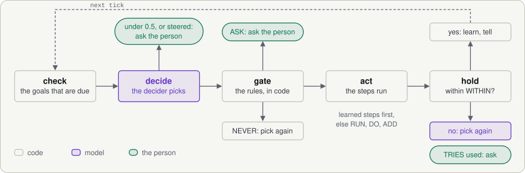

# Subweave

A Weavefile says what must stay true on a Linux box. The Subweave daemon keeps it true: it installs, watches, repairs, backs up and upgrades one service, and escalates to an agent or a person what it should not decide alone.

<picture>
  <source media="(prefers-color-scheme: dark)" srcset="docs/img/hero-dark.svg">
  
</picture>

```
subweave run postgres "postgres 18 for our app, private network, backups to s3://acme-pg/db1"
```

<picture>
  <source media="(prefers-color-scheme: dark)" srcset="docs/img/loop-dark.svg">
  
</picture>

- **Code** checks numbers, runs learned commands and enforces named rules.
- **The decider** (default [Jev](https://docs.typesafe.ai), a System One model) checks the request against the weave's `ARG`s, picks the next action and judges text. Each decision is one short call to a small, low-cost model.
- **The coder** (default DeepSeek) writes each box's commands once, and does the open-ended tasks, one gated shell command at a time.
- **Escalation** takes what code, the decider and the coder cannot settle to its targets: an agent conversation in [Steery](https://steery.dev), an agent command on the box, Telegram, or an agent over MCP, `subweave mcp`. The target decides whether to bring in a person. An agent may fix the weave; a rule change waits for the person's signed answer ([Escalation](WEAVEFILE.md#escalation)).
- **Channels** take the daemon's messages: Steery, Telegram, Slack, email, webhooks.

The run picks both models; a Weavefile only hints. One [OpenRouter](https://openrouter.ai) key runs every weave here ([Models](WEAVEFILE.md#models)).

The format is in [WEAVEFILE.md](WEAVEFILE.md): capital keywords, as in a Dockerfile, and one file per service. A weave says what, and keeps commands for when the exact command is the knowledge:

```Dockerfile
ARG bucket  SHOULD "an S3 URL for base backups and WAL, like s3://acme-pg/db1"

FACT disk  "percent used of the filesystem that holds /var/lib/postgresql, a number"
GOAL room  EVERY 5m  disk < 85

ACTION free-disk FOR room WITHIN 10m
  WHEN "old logs, not data or WAL, fill the disk"
  DO   "delete compressed PostgreSQL logs older than 7 days and shrink the systemd journal to 200 MB"
```

`subweave plan` checks a request before anything runs, and shows each finding as an error, an ask, a warning or info:

```bash
$ subweave plan postgres "postgres 18, private network, backups to acme-pg, keep 14"

# error    bucket    `acme-pg` is not an S3 URL for base backups and WAL, like s3://acme-pg/db1   0.04
# info     version   18   0.73
# info     access    private: connections from the private network, with a password and TLS   0.95
```

## Examples

| Weave | For | Box | Shows |
|---|---|---|---|
| [postgres](https://github.com/subweave/library/tree/main/postgres) | a 6-person SaaS team with no DBA | Hetzner VM, object storage | the reference: skills, restore drills, a major upgrade by sentence |
| [ethereum](https://github.com/subweave/library/tree/main/ethereum) | a wallet startup leaving hosted RPC | dedicated server, 2 TB | a `MUST` network, thresholds as code, gated coder commands |
| [vllm](https://github.com/subweave/library/tree/main/vllm) | a team serving its own open model | rented GPU | a `MUST` model, faults the box cannot fix |
| [store-edge](https://github.com/subweave/library/tree/main/store-edge) | a 300-shop retail chain | fanless PC on DSL | no coder, works offline, a heartbeat |
| [valkey](https://github.com/subweave/library/tree/main/valkey) | an agency with 40 client boxes | small VMs | a `MUST` role, one inbox for every box |
| [minecraft](https://github.com/subweave/library/tree/main/minecraft) | a teacher with a coding club | one VPS | untrusted text, update and rollback |

The weaves live in [subweave/library](https://github.com/subweave/library); `examples/` is its submodule (`git clone --recursive`).

Each weave's README says what it cannot do. [LIMITS.md](LIMITS.md) says what Subweave does badly, with the decider calls that show it in [evidence/](evidence).

## Dashboard

`subweave dash` serves a web dashboard for a box: goals, live activity, metrics, logs, learned commands and the weave. From it you answer escalations, run an action, give the coder a task in words (`subweave task` on the CLI) and change settings in words. It always needs a password: set one with `subweave dash --password`. It listens on 127.0.0.1:7400; `--bind 0.0.0.0` opens it to the network, and `subweave dash --install` makes it a systemd unit. See [Dashboard](WEAVEFILE.md#dashboard).

## Metrics, logs, traces

The dashboard serves Prometheus metrics at `/metrics`, a view of each service's journal and the state folded from it, and the box's vitals. A scrape from the box itself needs nothing; from elsewhere, or through a proxy that sets `X-Forwarded-For`, the dashboard password as a bearer token:

```yaml
scrape_configs:
  - job_name: subweave
    authorization: { credentials: "<dashboard password>" }
    static_configs: [{ targets: ["box.example:7400"] }]
```

| Metric | Type | Labels | What |
|---|---|---|---|
| `subweave_goal_holds` | gauge | service, goal | 1 when the goal holds |
| `subweave_goal_state_seconds` | gauge | service, goal, state | seconds in the current state |
| `subweave_checks_total` | counter | service, goal, ok | check lines: a result that changed, or hourly |
| `subweave_fact_value` | gauge | service, fact | newest value of a numeric fact |
| `subweave_actions_total` | counter | service, action, goal, ok | actions ended; ok: the goal held within `WITHIN` |
| `subweave_action_duration_seconds` | histogram | service, action | an action's steps and `WITHIN` wait |
| `subweave_step_duration_seconds` | summary | service, kind | commands, checks, decisions, learns, coder conversations, tasks |
| `subweave_episodes_total` | counter | service, kind, outcome | repairs, tasks, learns ended: ok, failed, asked, wait, learned |
| `subweave_goal_recovery_seconds` | histogram | service, goal | first failing check to the check that holds again |
| `subweave_asks_open` | gauge | service | escalations waiting for an answer |
| `subweave_asks_total` | counter | service | escalations raised |
| `subweave_answers_total` | counter | service, by_kind | person, withdrawn (goal held again), always (a kept answer passed a rule) |
| `subweave_model_cost_usd_total` | counter | service, model, role | spend; role decider or coder |
| `subweave_model_tokens_total` | counter | service, model, type | input, cached, output, reasoning; the decider's rule and quoted-goal checks count in cost only |
| `subweave_model_calls_total` | counter | service, model | model requests, as above |
| `subweave_box_cpu_ratio` | gauge | | CPU busy share (Linux) |
| `subweave_box_memory_used_ratio` | gauge | | memory in use (Linux) |
| `subweave_box_load1` | gauge | | one-minute load (Linux) |
| `subweave_box_disk_used_ratio` | gauge | mount | used share of each filesystem (Linux) |

Journal lines that time a step (command, check, decide, learn, the end of a coder conversation, a task's end) carry `ms`.

The daemon and dashboard log to stderr: JSON lines off a terminal, text on one. `SUBWEAVE_LOG` filters as `RUST_LOG` does (default `info`), e.g. `SUBWEAVE_LOG=subweave=debug`.

With `OTEL_EXPORTER_OTLP_ENDPOINT` (or `OTEL_EXPORTER_OTLP_TRACES_ENDPOINT`) set, the daemon sends traces over OTLP http/protobuf: one per episode, its trace id the episode's `ep`, a root span for the repair, task or learn and a child span per journal line. Service `subweave`, with `host.name`.

```sh
systemctl edit subweave   # [Service] Environment=OTEL_EXPORTER_OTLP_ENDPOINT=http://127.0.0.1:4318
```

## For weave authors

`subweave review <weave>` scores a Weavefile from 0 to 100 against its authoring rules and points at the lines to fix. The shipped postgres weave passes every rule.

## License

[MIT](LICENSE)
